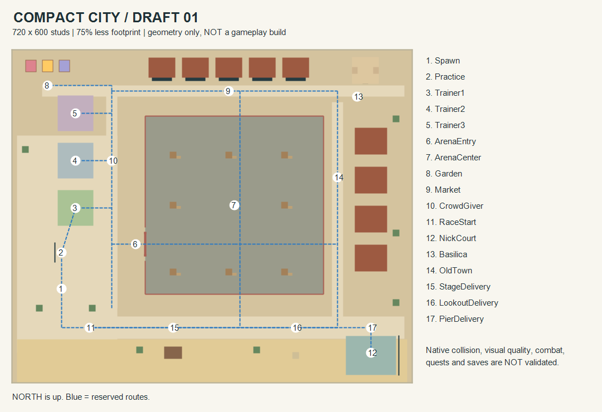

# Compact City Draft 01

Historical isolated-geometry checkpoint `6f81b9f`. The later current gameplay integration is documented in [COMPACT_CITY_INTEGRATION_REVIEW.md](COMPACT_CITY_INTEGRATION_REVIEW.md); statements below about unchanged production describe this earlier checkpoint, not the integrated candidate.

## What exists now

A separate, locally buildable geometry draft, not a replacement wired into gameplay. The current `default.project.json`, all 57 production scripts, quest/save data and original map remain unchanged. The draft is 720 by 600 studs versus the current 1440 by 1200, a 75% reduction in footprint. Its central arena is 320 by 320 studs.

First-minute layout: west safe courtyard -> nearby west-facing practice target -> first trainer, with a dedicated path beside three reserved trainer pads. The direct marked spawn/practice/rookie route is about 149 studs (about 9.3 seconds at the existing 16-stud walk speed before stops, turns or setup). That is a geometric estimate, not a measured player session. North market/garden/basilica and east old-town blocks retain recognizable districts; the south promenade reserves delivery, race and court locations. Arena cover is static in this draft.

There are 129 geometry parts plus 17 nonblocking anchor markers, including a SpawnLocation. All 146 are anchored. The always-visible draft notice and marker labels explicitly say gameplay is not implemented. No production server, microphone/UI, save, commerce, remote or external asset dependency is imported. The only script checks local Studio/PlaceId zero and static geometry membership.

## Exact original preserved first

Before authoring the smaller layout, preserved commit `72c886cb6f8a60ab26dff962e28da77e4b2d4609` under `assets/drafts/original-city-2026-11-11/`:

- 59 original tracked runtime files: 57 source scripts, project and fountain template. Per-file hashes and a deterministic exact-byte ZIP.
- Extraction verified against each hash and Git blob; all 57 scripts compiled. Normal build source correspondence and separately guarded draft source correspondence passed.
- Guarded original `.rbxl` and `.rbxlx` are retained with hashes. They assert local unpublished Studio, enable temporary profiles and defensively disable profile Load/Save.
- Independent review verified all archive bytes and guards. Scoped Git attributes preserve binary/artifact hashes under Windows line-ending conversion.

This is a recoverable copy of the **repository-generated city**, not a backup of unseen live-place changes or unsaved Studio edits. External Roblox asset contents are not archived. Root-level old `ScreamSimulator.rbxl/.rbxlx` were not used as backups because they predate current development. Read the preservation README before restoring into a new empty directory; never overwrite current work blindly.

## Build and inspect safely

Run `python tools/build_compact_city_draft.py`, then `python tests/compact_city_draft.py --negative-controls --built-check`. The optional `--scope-check` was a one-time assertion at `6f81b9f` that production still matched the archived original; it is expected to fail after authorized integration. The builder verifies original preservation, validates geometry, generates the task-owned model/notice, compiles the guard, builds XML/binary places and audits actual built geometry/scripts. It records source/artifact hashes. It does not launch Studio or publish.

Open `build/CompactCityDraft.rbxl` only as a local unpublished Studio file. The map exists in Edit mode; Play only supplies a normal avatar for geometry inspection. It has no beam attacks, trainer AI, quest interactions, saves, purchases, live voice setup or minimap. Do not publish. `tools/render_compact_city_plan.ps1` optionally draws an offline top-down plan using built-in Windows drawing APIs; that image is not a Roblox screenshot.

## Review findings and verification

- Independent layout audit reserved the northwest trainer corridor from garden/landmark overlap.
- The first practice target was beyond a level-1 beam's maximum range. Moved target/backstop closer: target center is about 11.2 studs from the practice anchor, within the current 12-stud minimum nominal level-1 range. This is geometry/rule alignment, not an exercised attack or microphone test.
- Exact segment/AABB corridor checks use four-stud horizontal clearance, ignoring floor-level and above-head parts. Trainer 32-stud eligibility disks remain outside the planned arena and map edge; 22-stud roaming space is reserved. These checks do not prove pathfinding, humanoid collisions, multiplayer pushing or combat safety.
- Final counts, controls, build hashes and independent-review outcome are in `tests/evidence/compact-city-draft-2026-11-11.json`.

## Integration work still required

Preserve these saved quest IDs without resetting progress: `nick`, `garden`, `beach`, `delivery`, `crowd`, `sprint`, `dodge`, `arena`. Preserve delivery IDs `StageDelivery`, `LookoutDelivery`, `PierDelivery`. Anchor labels are **placeholders**, not quest implementations.

Before replacing the current gameplay map, migrate City/World generation, spawn, NPC homes/navigation/jobs/seats and all spatial activity queries together. Re-map Config arena/map/delivery bounds, CityMap projection/landmarks, sports/race/coastal recovery checks and Bootstrap distance gates. Keep trainers outside PvP, verify reset/respawn and pad-edge attacks, and keep all environment cover static: the owner excludes object destruction, so destruction/repair must not be integrated. Shorter routes change timed-task difficulty; do not silently claim existing quest balance transfers unchanged. The reserved small court may need redesign for Nick's current multi-stage game.

Native walkability, camera/label readability, real physics and initial gameplay integration are still unrun. No connected document-control session was available; Studio was not launched to avoid creating more inaccessible app-picker dialogs. No apps opened, live stores, audio configuration or publication. Three earlier minimized dialogs remain unchanged.
