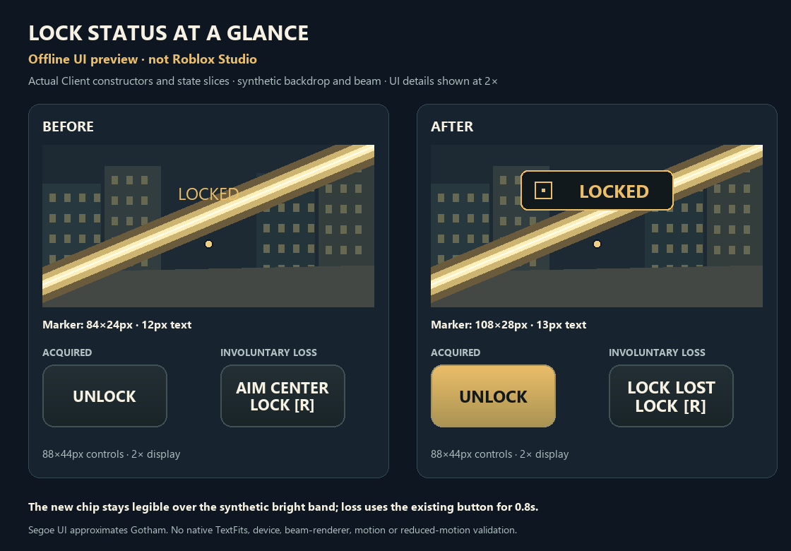
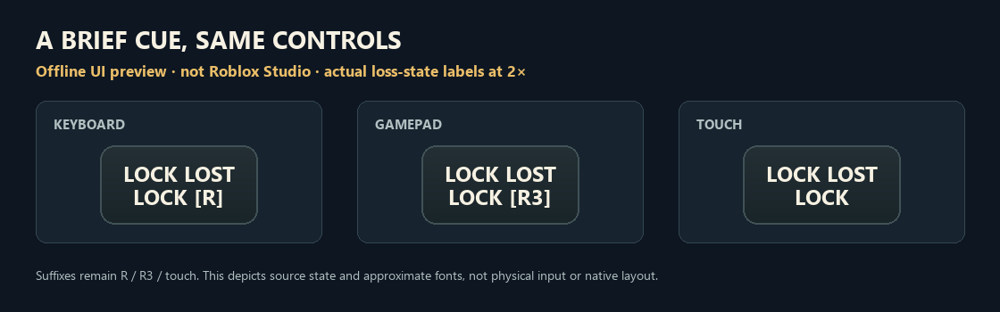

# Lock-on visual feedback

November 13, 2026. Completed lock presentation change, integrated into existing draft PR #1.

## Visible result

The acquired target now has a compact navy/gold badge with a geometric target symbol and bold **LOCKED** text. The existing lock button turns gold while acquired. An involuntarily lost target immediately loses its marker and produces **LOCK LOST** in that same button for 0.8 seconds, retaining the R/R3/touch action label. Manual unlock and menu, cancellation, respawn, focus, eligibility and OFF transitions clear the presentation state.

These are **offline previews**, executing actual Client UI constructors/update fragments and the real LockOn controller with synthetic services. The backdrop and bright band are illustrative, not the game renderer. Details are shown at 2×; Segoe UI approximates Gotham. They establish source-state and approximate visual comparisons, not native TextFits or actual beam readability.

The badge is 108×28px with 13px text, replacing transparent 84×24px/12px text. A 12px square/dot symbol and explicit text lane avoid ambiguous nested padding. The existing 88×44px button now uses 12px text. The caption alone nudges inward at viewport edges to keep an 8px margin; it hides below 124×44px. The selected target and submitted aim point stay unchanged.

## Behavioral boundary and checks

Only `Client.client.luau` changes production. A presentation wrapper calls the existing `Resolve` once, forwards both returns unchanged, and observes retained-target loss at both aim sampling and marker refresh. It adds no selection rule, target retention, reacquisition, camera movement, remote, subscription, scheduled task or animation. `LockOn.luau`, combat rules, damage, voice behavior, settings, assets and permissions remain unchanged. Three older voice fragment fixtures only gain a presentation-table dependency; their existing assertions remain.

- Final focused integration: **433 actual-slice/controller assertions, one source contract, 20 negative controls**. Covers cover/range/death/offscreen losses in both call orders, expiry without extension, no ghost or automatic reacquisition, manual/policy resets, input suffixes, constructors, viewport thresholds/corners and unchanged submitted aim.
- Retained controller: **558 assertions/six controls**. Retained voice checks: toggle 29; eligibility 71+30+16; notice lifetime 1,217; direct-ready 61/three contracts/six controls. Synthetic services only.
- Astra independently cleared production and both images. Historical 65 integration assertions still pass with dependency-only adaptation; independent 32 wrapper/call-count assertions and 2,108 viewport checks pass. Added invalid-target cases bring the integration sample to 469; duplicate-Resolve, dropped-return and missing-small-viewport-guard controls fail as expected.
- Final exact-source local aggregate: **243 commands pass in 52.61s**, with 25 pure/synthetic suites, 132 mocked suites, 64 production compiles, all 16 builders and six generated compiles. All **329** selected input fingerprints and the immutable output log were rechecked. This is local execution, not CI. An earlier pre-refinement 243-command pass is retained separately.

[Portable integration evidence](NOVEMBER13_INTEGRATION_REVIEW.md) records the published source/tests and portable verification. Machine-local observations and logs remain private.

## Limits and next action

Native Gotham/TextFits, layout rounding, device safe-area insets, physical inputs, actual beam/full-HUD overlap, motion/reduced-motion acceptance, device performance and real voice/multiplayer/save-release acceptance remain unverified. The 8px clamp is a viewport margin, not a device safe-area solution. No gameplay or performance benefit is claimed.

Subsequent [native map/lock validation](NATIVE_VISUAL_VALIDATION.md) covers the sampled glyph and input states. Physical-device, full-HUD and multiplayer acceptance remain separate.

Vault sources: **VFX Readability and Value — Lessons from Blind Reviews**, §1 lines 23–36 (dark contrast behind bright layers); **HUD Design**, §1 lines 24–43 (existing action areas and restrained central feedback); **Combat Sound Design and Feedback**, §§1–2 lines 24–46 (distinguishable outcomes). These informed visual feedback only. Reference lock-on camera/timing suggestions were not adopted.
