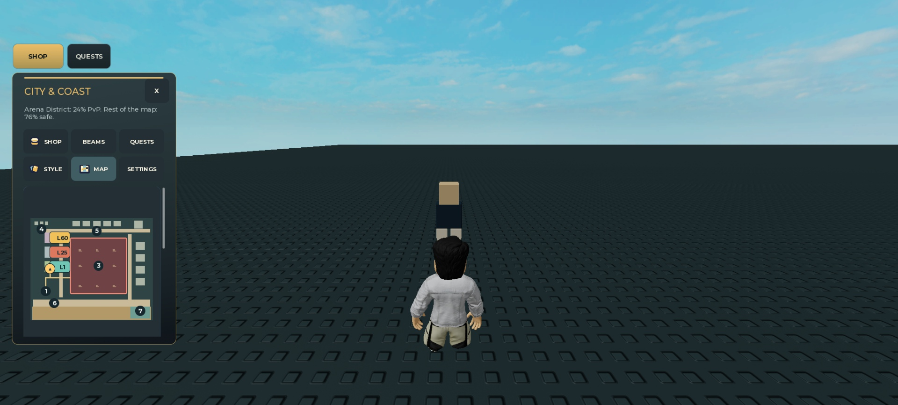
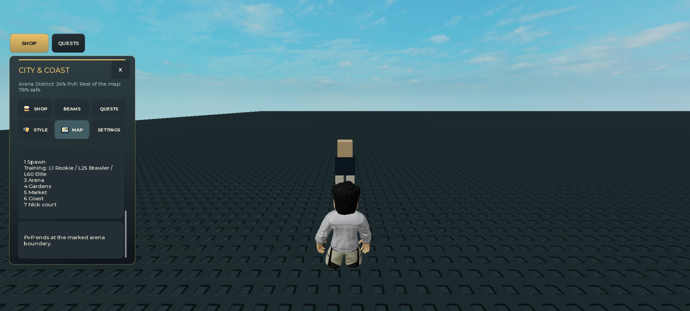
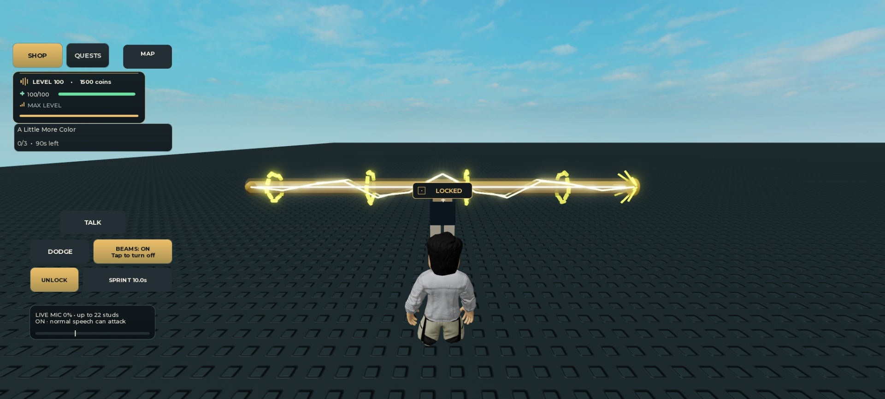
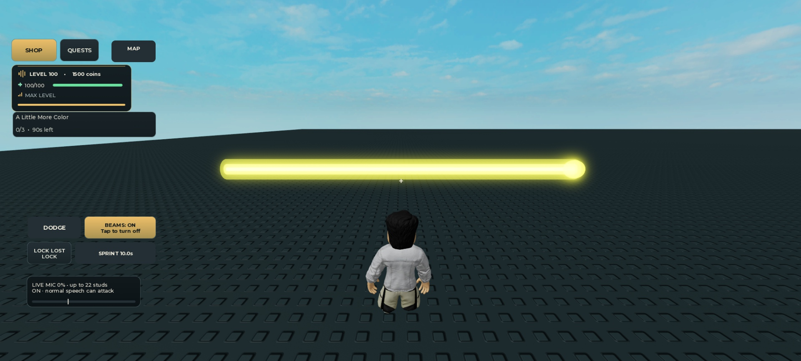

# Native map and lock-on validation

November 13, 2026. Tested the production source at `54ff32d`, preserving `4f6b606` and `ab0c2a0`. This validation adds evidence only; production source is unchanged.

## Result

The compact-map spacing and lock indicator render successfully in a disposable single-client Studio Play. **24 native snapshots, five supported simulated input operations and 21 screenshots** were independently reviewed by Astra. Its 342 evidence/integrity checks found no new defect within this scope.

The smallest allocated UI was 320×568, inside a real 1626.4×734.4 desktop viewport. This is native Roblox layout and font evidence, **not a physical phone test**. Map allocations of 390×844 and 1280×720 were also sampled. Taller allocations and some lower HUD areas extend beyond the capture, so these do not establish whole-device reachability or complete HUD fitting.

The 320px full map measures 222×185px. Numbered pins measure 18px and Spawn/Coast retain **8.52px circular clearance / 3.58px vertical rectangle clearance**. At 390 and 1280 allocation widths, pins remain 23px. No static-marker rectangle overlaps were reported. Training labels fit; the 320px legend wraps and fits after scrolling it into view. The 320px minimap remains collapsed; its hidden tiny map is not a readability result.

The acquired chip and button text fit. Native LockText measures 48.8×12.8px in a 76×28px lane; the icon-to-lane gap is 6px. The badge remains readable over the sampled actual regular and reduced beam geometry. The beams are static samples from the current renderer, not attacks or damage confirmations.

The loss screenshot captures **LOCK LOST** before expiry; its observation reports about 0.75 seconds remaining. The marker disappears immediately and the later screenshot returns to AIM CENTER/LOCK. Reacquisition, manual unlock and cancellation produce the expected native states. Pointer input acquired a target and opened the map; R unlocked/reacquired, and B closed the map. Inputs use Studio MCP's supported simulation, not physical touch or controller hardware. A final read reports no visible TextFits failures in the sampled 320px HUD state.

## Identity and fixture limits

Before each Play, the exact local file, artifact SHA256, normalized loaded-source length/checksum and embedded source identity were checked. Studio/universe/place IDs were verified as **Studio=true, GameId=0, PlaceId=0**. Every test/input operation also checked 0/0 identity. No hosted place was used.

The guarded fixture contains 31 current modules and the actual Client UI/controller code, with documented fake microphone/remotes/state, a scripted native dummy and a fixture camera/avatar pose. Server bootstrap/profile scripts are excluded. The real camera viewport is retained for lock captions; only HUD allocation is simulated. No app/device settings or production configuration was changed.

The original visual fixture artifact SHA256 is `e876ee0be1cac8832b1a3d4d02dbe267715fe2013a18681cc0f3a14b0373a786`. The input-only retry artifact is `8f95d64d47a6a01134eeeee8577c3666fe1c8993002ddf271edd40667202bdd7`. Both have the same reviewed production prefix; original files are preserved. The [portable integration summary](NOVEMBER13_INTEGRATION_REVIEW.md) records source/fixture bindings; full machine-local provenance remains private.

Two harness attempts are retained: the first pointer lookup used `Controls` instead of the actual `Actions` path and stopped before a click. A subsequent restart hit a transient 1×1 camera viewport before control publication and stopped safely. The input fixture gained only bounded stable-camera readiness and post-wait avatar validation, then passed the five native input operations. No production fix was required. No simultaneous multiplayer test was run.

## Cleanup and remaining gaps

The fixture's explicit cleanup removed its UI, control, dummy and beam parts and unanchored the avatar. Cleanup returned CameraType.Custom; Studio MCP then explicitly logged that its execute wrapper reset this to Scriptable. Persistent camera restoration through that wrapper is not claimed. **Play was stopped; Edit mode, IsRunning=false and 0/0 identity were verified.**

Native edge-target clamp behavior, device safe areas, physical input, actual phones, real microphones, multiplayer, persistent saves, dense-world/full-HUD overlap, animated effects/comfort and GPU/frame-time performance remain open. Raw GUI coordinates have a core-inset origin offset; native input used verified instance paths, and raw rectangles are not a proof of physical edge margins. Existing asset-type mismatch warnings for `203785492` were observed and not resolved by this pass.

All 329 selected inputs from the retained `54ff32d` 243-command local report still match; that suite was not repeated for this evidence-only pass. These are historical local checks; genuine physical-device/voice/multiplayer acceptance remains separate.

Vault consulted: **UI Automation with VirtualInput and StudioTestService**, bounded input/native-state guidance, and **Responsive UI for Phone Tablet Console and PC**, viewport/real-placement checks. Their limits informed the explicit separation of native layout from physical-device acceptance.
