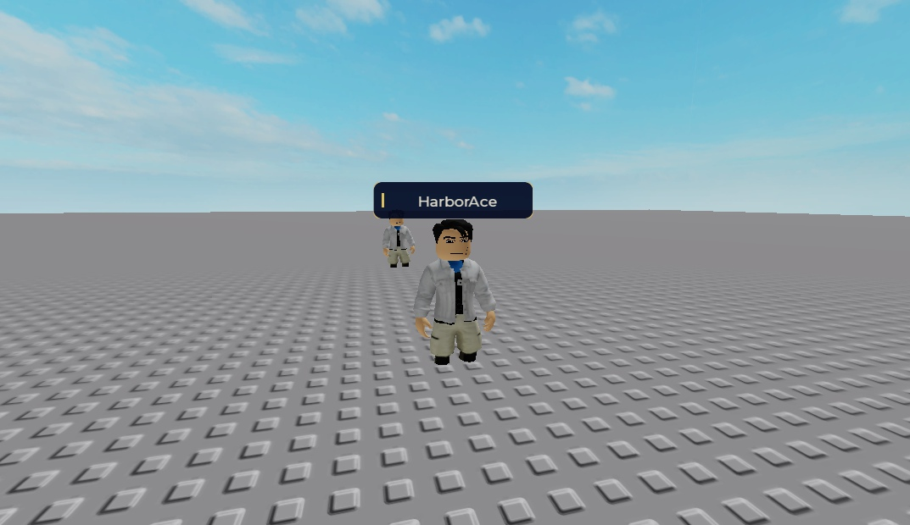
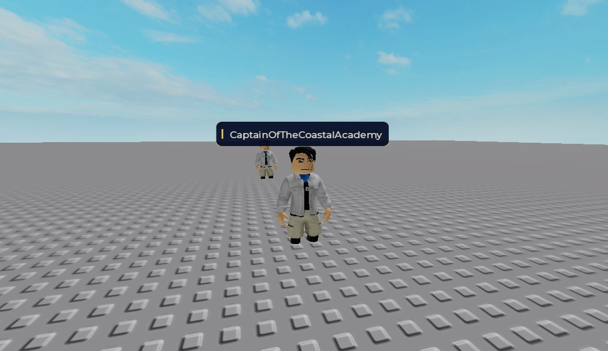
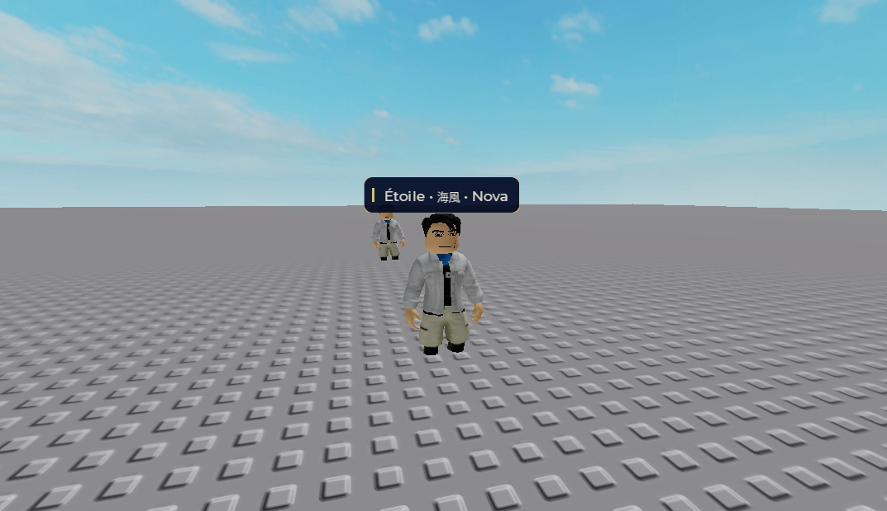

# Player-name art prototype, not a production replacement

November 13, 2026. Original navy/gold name-only art, native Studio rendering on an owned avatar clone. No production player code changed; no publication.

The three labels are readable in these recorded front views. Six art cases report native TextFits=true. Front captures use a separate unobstructed camera and are not evidence for the wall cases. The actual local player is visible in the background; the foreground subject is a clone, not a second Player. This is a bounded design prototype, not a shipped tag manager or a health-preserving replacement.

## What was verified

- Exact reviewed fixture source and local PlaceId/GameId0 before play. The sole Review script is ClassName LocalScript, Legacy RunContext; a broad IsA(Script) check initially counted it, so that count was not treated as a server script.
- Five native baseline states, six art states and four separate front-view states were recorded. The native name/health baseline remained blank even in an unobstructed view despite configured in-range/damaged state. This is unresolved and cannot validate real-player distance, occlusion, health, or suppression equivalence.
- Custom mode suppresses both native name and health on the owned dummy only, then draws a name. Actual viewer defaults are restored for art. No production display suppression, team policy, level/status labels or health manager was added.
- Whole-fixture mock smoke: 16 baseline checks/two deliberate-failure controls; 41 art checks. Both portable sources compile and relative Rojo projects build. No full aggregate was rerun for this prototype-only directory; its checks are separate from the preceding trainer game checkpoint.
- Stop removed the owned folder/control and restored viewer Viewer/100/100/OccludeAll/DisplayWhenDamaged, Custom camera and unanchored root. Play stopped; the exact task Studio process was closed and host inventory verified it absent. PC remains on.

[Portable source/build instructions](../prototypes/player-tags/README.md) and [scoped native evidence](../tests/evidence/player-tag-prototype-2026-11-13.json). Evidence omits account names from the packaged state snapshots; raw local artifacts are hash-bound. Vault overhead UI/visibility guidance and official Roblox name/health display documentation informed the boundary.

## Gate before production

A genuine second Player/client is required to verify normal name and damaged-health retention, self exclusion, neutral/team relationships, viewer/subject distance precedence, both client views, join/leave/respawn and replication. The official MCP currently exposes single Play/Stop, not a player-count launch; supported desktop inventory exposed no Studio window for local-server controls. No fabricated Player object or clone substitutes for that test.

Keep current production native player displays unchanged until this baseline is observed and a health-preserving integration is reviewed. Physical phones, gamepads, OS text sizing and performance are also unverified. The prototype's 80-stud camera-based Billboard distance is an art bound, not a replacement for the observed native 100-stud viewer policy.
