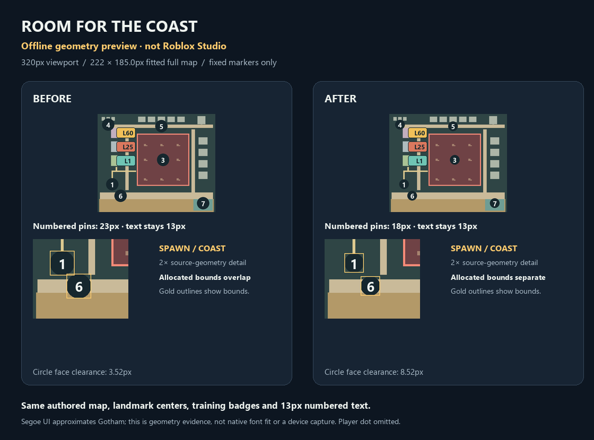
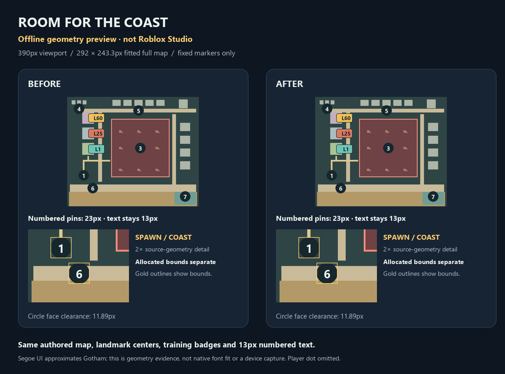

# Small-screen map spacing

November 13, 2026. Completed compact full-map spacing change, integrated into existing draft PR #1.

## Visible result

Numbered full-map pins now respond to the fitted map width, between 18 and 23 pixels. Their numbers stay at 13 pixels. At a 320px viewport the fitted map is 222×185px: Spawn and Coast gain five pixels of breathing room, and their allocated rectangles separate. At 390px and wider the previous 23px pin size remains.

These are **offline geometry previews, not Studio screenshots**. The actual CityMap constructors execute in the existing Luau mock; Pillow renders their resulting frames and approximates Gotham with Segoe UI. The moving player dot is omitted. The previous circular faces already had 3.52px clearance at 320px; the reported overlap was between their bounding rectangles. The candidate increases face clearance to 8.52px and vertical rectangle clearance to 3.58px.

## Scope

Five added lines in `CityMap.luau` scale only the six compact-world/full-map numbered pins and apply a native `UISizeConstraint`. Equal axis limits preserve square pin bounds. [Roblox's size-constraint documentation](https://create.roblox.com/docs/ui/size-modifiers) confirms the child constraint's minimum/maximum behavior.

Landmark centers, projection, geometry, 13px glyphs, training badges, player marker, legacy map and minimap remain unchanged. No new event subscription, update loop, remote or per-frame allocation. The primary worktree and its independent contributor edits were preserved.

## Verification

- Focused `training_map.py --negative-controls`: **754 assertions, two unchanged-source contracts, 11 controls**. Geometry resolves actual scale sizes and size constraints at 320/321/340/360/385/386/390/640/1280px, including a repeated 320 allocation. Every static-marker pair requires two pixels of rectangle clearance. Historical glyph samples are explicitly assumptions, not candidate native TextFits.
- Retained `compact_city_map.py --negative-controls`: **102 assertions, ten controls**. Retained `minimap.py --negative-controls`: **138 module and 987,779 combined assertions, 16 controls**, all mocked.
- Astra independently cleared the production change, historical `ab0c2a0` clearance failure and constraint/aspect mutants. A separate half-pixel width sweep from 320 to 1600 passed **175,969 modeled assertions**. Astra also inspected both offline images; no visual-preview defect found.
- Final default-Python local run: **243 commands passed in 57.15s**, comprising 25 pure/synthetic suites, 132 mocked suites, 64 production compiles, all 16 build commands and six generated compiles. All **329** selected input hashes and the immutable output log were rechecked. This is local execution, not CI.

[Portable integration evidence](NOVEMBER13_INTEGRATION_REVIEW.md) records source, fixture and integration checks. Detailed machine-local observations and logs remain private.

## Native limits and next action

Subsequent [native map/lock validation](NATIVE_VISUAL_VALIDATION.md) covers the sampled layout/font states. Below-320px full-map layout is outside this pass. Existing real-microphone, multiplayer and save-release gates remain open.

Next: genuine device/resizing/player-marker-crossing acceptance.

Vault sources used: `05 UI and UX/Minimap and World Map UI - Projection, Rotation and Fog of War`, §4 Markers (lines 86–92), and `05 UI and UX/Responsive UI for Phone Tablet Console and PC`, §2 Numbers/automation (lines 143–151) and §4 Small-screen strategies (lines 181–206). Their projection/readability guidance informed the preserved coordinates and source-derived spacing checks; no imported instruction authorized external actions.
