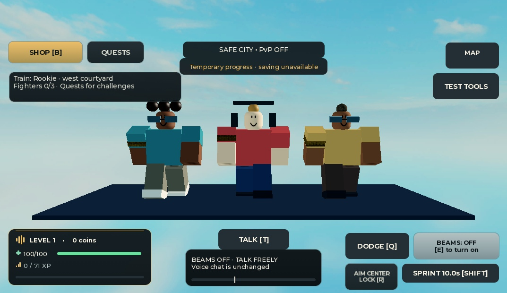
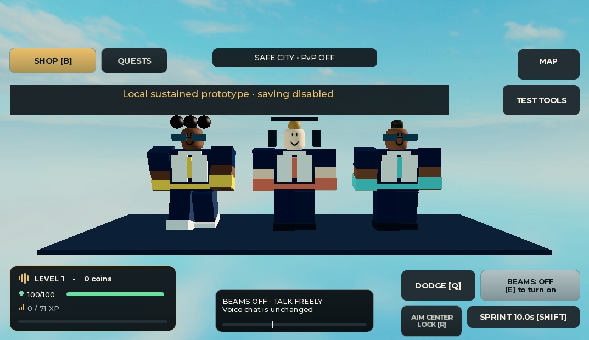
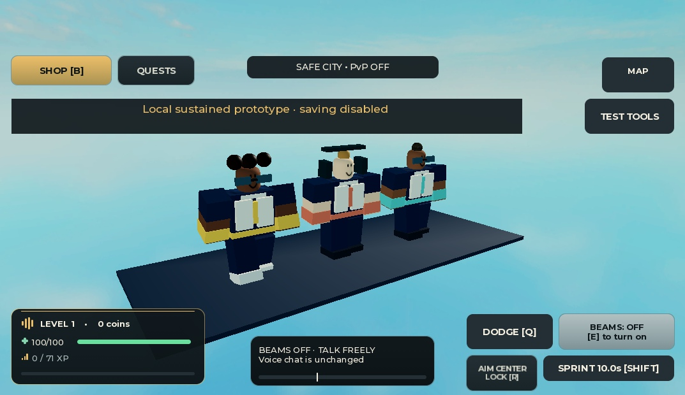
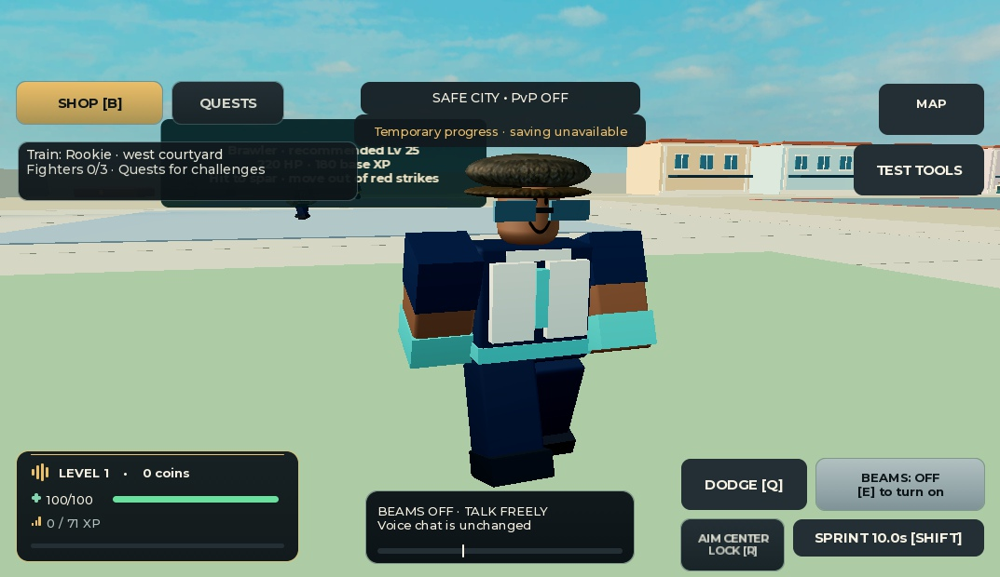

# Original academy trainer outfits

November 13, 2026. Draft-only, against `d05f431`. No Roblox publication or live data.

## Visible result

The three trainers now share a navy/ivory sparring kit, with mint Rookie, coral Brawler and gold Elite wrist/belt/center accents. Existing skin, hair, faces and rig remain. A first native Fabric version looked muddy; the accepted version uses SmoothPlastic and matching navy sleeves. This is an original primitive-based costume, not an imported Blender mesh or third-party asset.

The fixed gallery camera looks toward +Z, so the image order is Elite, Brawler, Rookie. Gallery clones preserve a captured pose, not an identical animation phase. Billboards were hidden only on display clones. Separate actual-trainer captures show the outfit in existing local animation poses.

## Scope and verification

- Only `World.luau` changes production behavior: eight cosmetic Parts and eight body-attached WeldConstraints per trainer. All are unanchored, massless, noncolliding, nonquery and nontouch. Torso/legs and existing safe sleeves receive navy colors; old trainer Jacket/FighterArmband remain but are transparent. Nontrainer uniforms, all body sizes/joints, stats, IDs, rewards, movement and RNG calls are unchanged.
- `python tests/trainer_models.py --negative-controls`: 701,178 actual-constructor differential property assertions, one exact unchanged-source contract and seven controls. The local Git baseline object is required; the test never fetches it. Instances, CFrames and random values are mocked; it verifies draw sequence/bounds, not Roblox's numeric RNG implementation.
- `python tests/verify_local.py --build --report build/trainer-models-final2.json`: all 242 commands pass, 25 pure/synthetic suites, 131 mocked suites, 64 production compiles and review builds. All 328 input fingerprints and the log were rechecked. This is local execution, not CI.
- Independent Astra review passed the focused checks, exact scope and native art review. Actual after-source equality was verified in a disposable local place/universe 0. Matched front/three-quarter/back captures and two actual-trainer snapshots per tier were inspected. All eight live accessory flags remained safe and motors changed. Rookie/Brawler moved about four studs; Elite moved only .019 stud, so that sample does not establish Elite roaming.
- Display-clone Humanoids initially rewrote body collision flags. The corrected appearance-only gallery removes clone controllers before parenting, then all final records report zero unsafe parts. Originals are untouched. Studio resets camera changes after `execute_luau`; captures use the official screenshot tool's explicit camera parameters. The initial Fabric/capture attempts were not accepted as final evidence.

[Machine-readable evidence](../tests/evidence/trainer-models-2026-11-13.json) binds source, test, raw records and images. Vault lookup: `55 Modelling Nuance and Readability/Shape Language and Silhouette Testing`, especially small-screen/three-quarter views and clear secondary color blocks; author/reviewer also consulted animation-safe weld/assembly guidance.

## Limits and cleanup

No full combat/death/respawn, multiplayer, real-device, frame-time or microphone validation is claimed. Added geometry has a cost, even though it adds no loops. Existing hair/headphone oddities are unchanged and outside this costume checkpoint. Gallery properties/TextFits of hidden billboards do not prove tag readability. Player overhead name/health rules remain native and unchanged.

Play stopped and original World was restored, with Client unchanged, before a transport interruption. After supported reattach, an ordinary sandbox process query misleadingly hid the still-running host process; this was corrected using escalated CIM. The exact task-created process was then closed (no main window accepted normal close) and escalated CIM verified it absent. No user program was closed. PC remains on; no shutdown requested.

Next: bounded player-tag art exploration and genuine two-player policy/visibility validation before any production replacement. Existing real-mic/multiplayer and mixed-version save release gates remain open.
