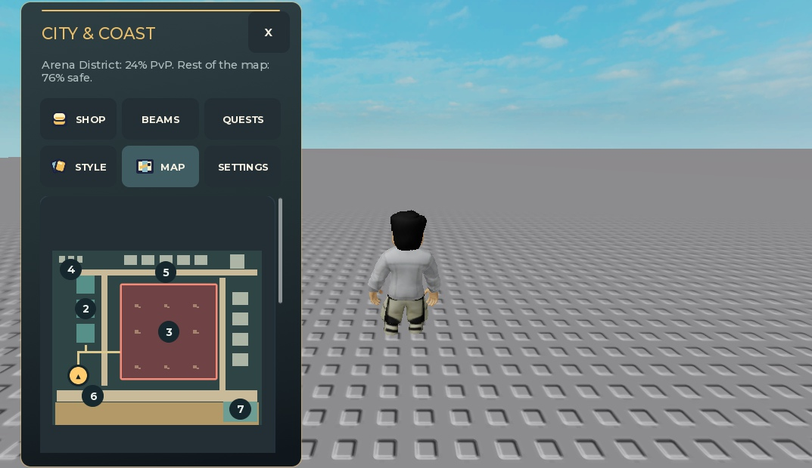
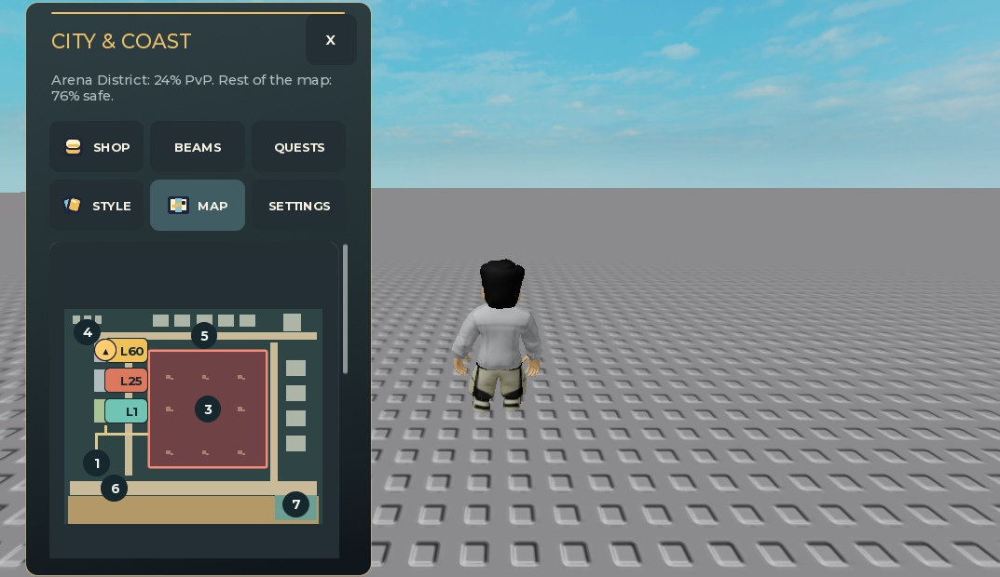
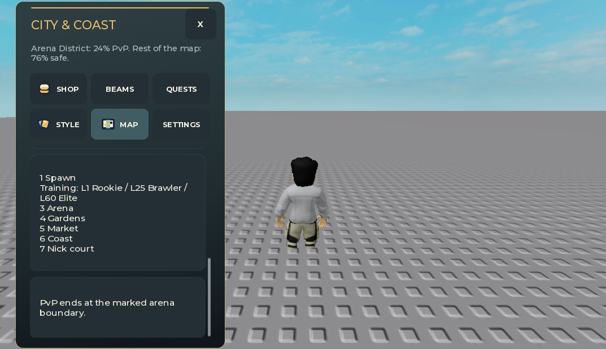
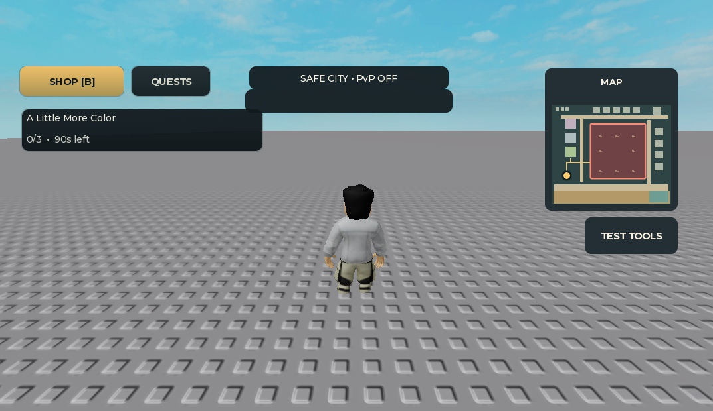

# Training map readability

November 13, 2026. Draft-only against `5622daa`; no Roblox publication.

## Visible result

Training pads now retain their actual world colors on the minimap. The full map replaces one ambiguous training pin with mint **L1**, coral **L25** and gold **L60** badges, matching the trainer outfits. The legend identifies Rookie, Brawler and Elite. No world geometry or gameplay changed.

The full-map images deliberately translate only the disposable preview root upward by 130 logical pixels so the map/legend fit the smaller Studio capture viewport. These are focused native art views, not whole-phone screenshots. Standard unshifted observations remain in the private local evidence.

## Scope

Only `CityMap.luau` changes production behavior. Physical pad colors come from existing `CompactLayout.PartSpecs`; badge colors echo the uniforms and do not recolor the world. Three static 36x20 badges use 12px text, with an 8px left text inset. The projected left-center badge anchors remain at the pad centers. The compact generic `2 Training` pin is removed; other numbered landmarks retain their identities/positions. Mini maps have no tiny new text.

Projection, footprint geometry, arena bounds, player marker styling/facing, update cadence, server visibility and legacy fallback are unchanged. No new dependency, remote, update loop or per-frame allocation. The original city archive and primary checkout's contributor edits are untouched.

## Verification

- `python tests/training_map.py --negative-controls`: **214 assertions, two unchanged-source contracts, seven controls**. The glyph dimensions used for a padding regression are explicitly recorded native samples, not a universal font model.
- Retained `compact_city_map.py`: **102 assertions and ten controls**. Its former requirement for the removed generic pin was adapted without relaxing other projection checks.
- `python tests/verify_local.py --build --report build/training-map-final3.json`: **243 commands passed**, 25 pure/synthetic suites, 132 mocked suites, 64 production compiles, 16 builders and six generated compiles. All **329** input hashes and the immutable log were rechecked. Local execution, not CI.
- Astra independently reviewed the source, focused controls, final native records and art. The first centered badge design overlapped Gardens on narrow maps; its left-anchor correction preserves projection. Native testing then found tight player-dot/L25 and L60 text contact. The final text inset gives measured glyph gaps of **8.2px / 3.4px / 3px** at the three pad centers in all three allocations.
- Final exact-source local place/universe 0 fixture: 33 standard records covering full/mini x three allocations x five synthetic positions plus three legend views, and seven focused records. All tier text fits; no tier/player text overlap in those sampled positions. Legends fit their scrollers, with the narrow training entry wrapping normally. The 320-touch minimap remains collapsed; its hidden map bounds are not a readability result.

[Portable integration evidence](NOVEMBER13_INTEGRATION_REVIEW.md) records the published source, portable tests and accepted native-image scope; raw local observations remain private. Final CityMap SHA starts `229cb6ad`; final fixture/binary `77e6c62b` / `ca5156be`.

## Limits, recovery and cleanup

The separate [small-screen spacing pass](SMALL_SCREEN_MAP_REVIEW.md) subsequently resolves the sampled 320px Spawn/Coast rectangle overlap. This is not a global label-decluttering fix: the player marker can still cross other labels while moving. Physical touch/gamepad input, OS text scaling, device safe areas, all viewport sizes, contrast accessibility and frame-time/memory performance remain unverified. Native testing uses fake microphone/remotes and synthetic avatar positions, not live navigation, multiplayer or saves. Real microphone/multiplayer and mixed-version save release gates remain open.

Native Play stopped and owned fixture UI/control objects were removed.

Vault: targeted `05 UI and UX/Minimap and World Map UI - Projection, Rotation and Fog of War`, `Race HUD - Position, Laps, Splits, Speedometer and Minimap`, and original-icon/readability guidance informed the bounded projection, non-color cues and small-map checks. No imported asset, upload or extra dependency.
